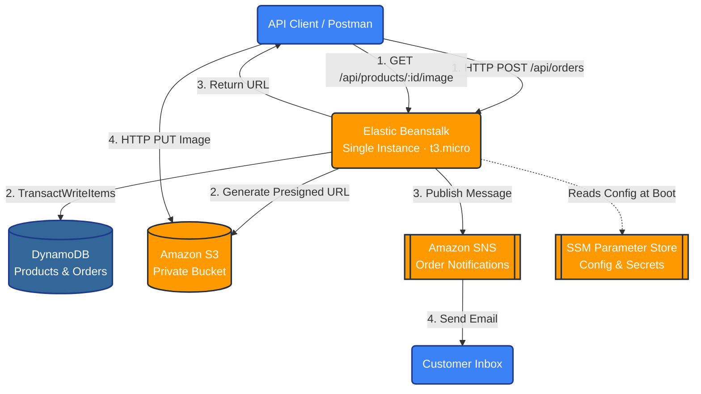
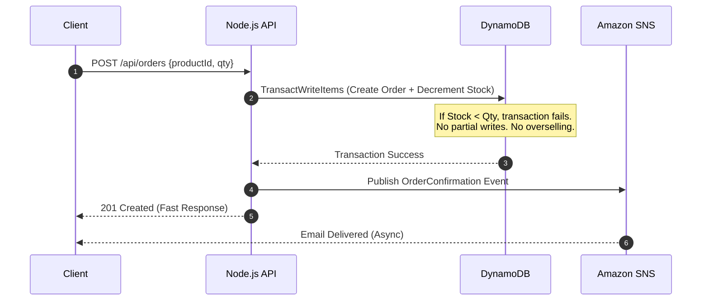

<div align="center">

# 🛒 ShopStack API — AWS Cloud-Native Backend

**A production-style Node.js e-commerce backend deployed on AWS Elastic Beanstalk.**

[](https://nodejs.org)
[](https://expressjs.com)
[](https://aws.amazon.com)
[](https://aws.amazon.com/dynamodb)

*Deployed in minutes. Zero hardcoded secrets. Cost-optimized for Free Tier.*

</div>

---

## 📖 Table of Contents

- [Overview](#-overview)
- [Architecture](#-architecture)
- [AWS Services Used](#-aws-services-used)
- [Key Technical Features](#-key-technical-features)
- [Cost Analysis](#-cost-analysis)
- [Repository Structure](#-repository-structure)
- [Local Development](#-local-development)
- [Deployment Guide](#-deployment-guide)
- [Lessons Learned](#-lessons-learned)
- [Future Improvements](#-future-improvements)
- [Author](#-author)

---

## 🎯 Overview

This project demonstrates a **cloud-native API architecture** on AWS, built end-to-end from scratch to showcase real-world cloud engineering:

- **Compute Tier** — Elastic Beanstalk Single Instance (EC2 `t3.micro`) running Node.js 22 and Express.
- **Data Tier** — DynamoDB On-Demand tables for `Products` and `Orders` (supporting atomic transactions).
- **Storage Tier** — Private Amazon S3 bucket for product images, secured via Presigned URLs.
- **Messaging Tier** — Amazon SNS for decoupled, asynchronous order confirmation emails.
- **Configuration** — AWS SSM Parameter Store for zero hardcoded secrets.

**The app itself is intentionally simple** (CRUD API) — the focus is the AWS architecture, security posture, and cost optimization.

### ✨ Highlights

- ✅ **Atomic Database Transactions** — Prevents overselling using DynamoDB `TransactWriteItems`.
- ✅ **Presigned URLs for S3** — Direct browser-to-S3 uploads without exposing the bucket or overloading the server.
- ✅ **Zero Hardcoded Secrets** — Configuration injected at runtime via SSM Parameter Store.
- ✅ **Least-Privilege IAM** — Custom IAM Instance Profile restricting access to only specific resources.
- ✅ **Free Tier Optimized** — Single-instance environment (No $16/mo Load Balancer).

---

## 🏗 Architecture

### High-Level Diagram



### Order Lifecycle (Atomic Transaction)



---

## ☁️ AWS Services Used

| Service | Purpose | Docs |
|---|---|---|
| **Elastic Beanstalk** | PaaS for automated EC2 provisioning and Node.js deployment | [docs](https://docs.aws.amazon.com/elastic-beanstalk/) |
| **Amazon EC2** | `t3.micro` single instance running the Node.js app | [docs](https://docs.aws.amazon.com/ec2/) |
| **Amazon DynamoDB** | On-demand NoSQL database for Products and Orders | [docs](https://docs.aws.amazon.com/dynamodb/) |
| **Amazon S3** | Private bucket for product images (accessed via Presigned URLs) | [docs](https://docs.aws.amazon.com/s3/) |
| **Amazon SNS** | Pub/Sub messaging for order confirmation emails | [docs](https://docs.aws.amazon.com/sns/) |
| **AWS IAM** | Instance Profile and Least-Privilege execution roles | [docs](https://docs.aws.amazon.com/iam/) |
| **SSM Parameter Store** | Runtime configuration storage (Table names, ARNs, Bucket) | [docs](https://docs.aws.amazon.com/systems-manager/) |
| **Amazon CloudWatch** | Centralized logging and environment health monitoring | [docs](https://docs.aws.amazon.com/cloudwatch/) |

---

## ✨ Key Technical Features

### 🔒 Secure Image Uploads (Presigned URLs)
The S3 bucket is 100% private (Block Public Access is ON). The backend generates a short-lived **Presigned URL**, allowing clients to upload images *directly* to S3. This saves EC2 bandwidth, CPU, and keeps the application highly scalable.

### ⚡ Atomic Transactions (Data Integrity)
Uses DynamoDB `TransactWriteItems`. When an order is placed, the system atomically decrements stock *only* if the stock is available. If two users buy the last item at the exact same millisecond, one succeeds and the other gets a graceful `400 Bad Request`.

### 🛡️ Zero Hardcoded Secrets
No `.env` files in the deployment bundle. Configuration is stored in **AWS Systems Manager (SSM) Parameter Store** and injected into the EC2 environment at runtime. 

### 🔑 Least Privilege IAM
The EC2 instance uses an IAM Instance Profile. It has *only* the exact permissions required (e.g., `s3:PutObject` on the specific bucket, `dynamodb:PutItem` on the specific tables). No root keys, no broad access.

---

## 💰 Cost Analysis

### Free Tier Limits

| Service | Free Tier | This Project | ✓ |
|---|---|---|---|
| **EC2** | 750 hrs/mo `t3.micro` | 1 × 24/7 | ✅ |
| **DynamoDB** | 25 GB (Perpetual) | On-demand, KB of data | ✅ |
| **S3** | 5 GB + 20K GET + 2K PUT | MBs of images | ✅ |
| **SNS** | 1M publishes + 1K emails | < 10 emails/mo | ✅ |
| **Elastic Beanstalk** | Always Free | 1 environment | ✅ |
| **SSM Parameter Store** | Standard params free | 4 params | ✅ |

### Cost-Avoiding Decisions

| Decision | Savings | Trade-off |
|---|---|---|
| **Single Instance (No ALB)** | ~$16/mo | No load balancing (sufficient for dev) |
| **DynamoDB On-Demand** | $0 vs Provisioned | Scales to zero automatically |
| **No NAT Gateway** | ~$32/mo | EC2 sits in public subnet (secured by SGs) |
| **S3 Private + Presigned URLs**| $0 | No CloudFront cost for direct uploads |

---

## 📁 Repository Structure

```text
shopstack/
├── .ebextensions/
│   └── options.config          # Elastic Beanstalk environment config
├── src/
│   ├── app.js                  # Express app entry point
│   ├── config.js               # Config loader (reads from env vars)
│   ├── routes/
│   │   ├── products.js         # Product routes
│   │   └── orders.js           # Order routes (Atomic transactions)
│   └── services/
│       ├── dynamodb.js         # DynamoDB Client
│       ├── s3.js               # S3 Presigned URL generator
│       └── sns.js              # SNS Publisher
├── .gitignore                  # Protects node_modules & .env
├── package.json                # Dependencies & engines
├── Procfile                    # EB start command
├── deploy.zip                  # Linux-compatible deployment bundle
└── README.md                   
```

---

## 🖥 Local Development

### Requirements
- Node.js 22+ · Git · Postman (or `curl`)

### Setup

```bash
# 1. Clone
git clone https://github.com/DeveloperMaher/shopstack-aws.git
cd shopstack-aws

# 2. Install
npm install

# 3. Configure
# Create a .env file for local testing:
NODE_ENV=local
AWS_REGION=eu-central-1
PRODUCTS_TABLE=shopstack-products
ORDERS_TABLE=shopstack-orders
BUCKET_NAME=your-bucket-name
ORDER_TOPIC_ARN=your-sns-arn

# 4. Run
npm start
```

Visit `http://localhost:3000/health` → `{"status":"ok","env":"local"}`

*(Note: Ensure your local machine has AWS credentials configured via `aws configure` to test database/SNS features locally).*

---

## 🚢 Deployment Guide

### Creating the Linux-Compatible ZIP
**CRITICAL:** Do not use Windows "Compress to ZIP" or `Compress-Archive` in PowerShell. They use backslashes (`\`) which crash the Linux `unzip` command on AWS.

Use the native `tar` command in PowerShell:
```powershell
tar -a -c -f deploy.zip .ebextensions src package.json package-lock.json Procfile
```

### Deploy to Elastic Beanstalk
1. Go to AWS Elastic Beanstalk Console.
2. Click **Upload and deploy** and select `deploy.zip`.
3. EB provisions the `t3.micro` instance, runs `npm install`, and starts the app via `Procfile`.
4. Environment status will turn **Green** (Health: OK).

### Verification
```bash
# Check target health
curl http://<your-eb-domain>/health
# → {"status":"ok","service":"shopstack","env":"production"}
```

---

## 🧠 Lessons Learned

Building this end-to-end surfaced several real production-grade issues. Each taught a specific lesson.

### 1. Windows ZIPs Crash Linux Servers
**Symptom:** `StageApplication` failed with "appears to use backslashes as path separators".
**Lesson:** Always use `tar -a -c -f deploy.zip ...` in PowerShell or Git Bash. Windows `Compress-Archive` creates path strings (`src\app.js`) that the Linux `unzip` binary cannot parse.

### 2. Elastic Beanstalk Node.js Version Strictness
**Symptom:** Deployment failed immediately because local Node (v22) didn't match EB's default platform.
**Lesson:** Always pin the Node version in `package.json` (`"engines": {"node": ">=22.0.0"}`) and ensure the EB platform environment matches exactly. 

### 3. `NodeCommand` is Deprecated on AL2023
**Symptom:** EB rejected the `.ebextensions` file with "Unknown or duplicate parameter: NodeCommand".
**Lesson:** Amazon Linux 2023 platforms no longer support `NodeCommand` in `.ebextensions`. Rely entirely on `package.json` scripts and the `Procfile` for the start command.

### 4. IAM Actions for DynamoDB Transactions
**Symptom:** IAM Policy validation failed for `dynamodb:TransactWriteItems`.
**Lesson:** `TransactWriteItems` is not an IAM action. IAM relies on the underlying item operations (like `PutItem`, `UpdateItem`, `ConditionCheckItem`). The SDK maps the transaction to these specific permissions.

---

## 🔮 Future Improvements

Documented here for transparency — these are the "if this were production" upgrades.

### Infrastructure
- [ ] **Private subnets + NAT Gateway** — Move EC2 out of public subnets for stricter security.
- [ ] **Load Balancer (ALB)** — Distribute traffic and enable zero-downtime deployments.
- [ ] **Route 53 custom domain + HTTPS** — Terminate TLS at the ALB.

### Security
- [ ] **AWS Secrets Manager** — Upgrade from SSM SecureString for automatic secret rotation.
- [ ] **Cognito** — Add user authentication and JWT verification.

### Observability
- [ ] **CloudWatch Agent** — Ship Express structured logs directly to CloudWatch Logs.
- [ ] **Custom CloudWatch metrics** — Business KPIs (orders per minute).

---

## 👤 Author

**Maher** — Full-Stack Developer

- 🐙 GitHub: [@DeveloperMaher](https://github.com/DeveloperMaher)
- 💼 LinkedIn: [Maher Shalash](https://www.linkedin.com/in/maher-shalash/)
- 📧 Email: [m.shalash@outlook.de](mailto:m.shalash@outlook.de)


---

<div align="center">

**⭐ If this project helped you learn AWS, consider giving it a star.**

*Built with ☕, Node.js, and a lot of `git push`*

</div>